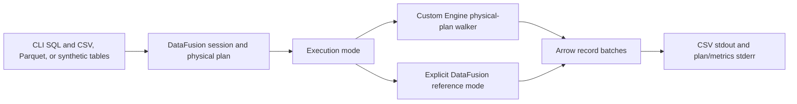
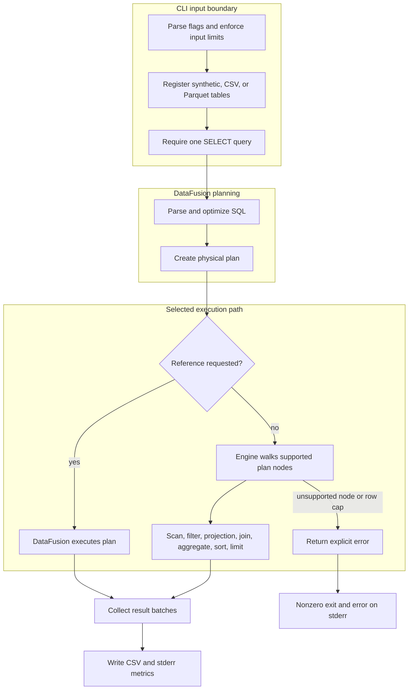

# SQL execution engine

## Contents

- [Architecture and execution guide](#architecture-and-execution-guide)
- [Run](#run)
- [Execution and limits](#execution-and-limits)
- [Verify](#verify)

This project is a bounded, noninteractive SQL runner built on the complete MIT-licensed CMU 15-721 Spring 2024 Execution Engine #2 capstone. The original Arrow operators, tests, data, and Git history remain here. This adaptation adds a usable CLI, an explicit custom physical-plan executor, exact-key joins/grouping, parallel partition workers, and differential verification. It is a portfolio adaptation, not a claim of original authorship or course completion.

Upstream is [cmu-db/15721-s24-ee2](https://github.com/cmu-db/15721-s24-ee2), baseline `4272268d129455f0e3059d27fe731748674bd3cd`, listed as Execution Engine #2 on the [official project showcase](https://15721.courses.cs.cmu.edu/spring2024/project-showcase.html). Preserve [LICENSE](LICENSE) and [README.upstream.md](README.upstream.md).

## Run

Requires Rust with an MSVC linker on Windows, or a normal Rust host toolchain on Linux. Cargo.lock fixes the application dependency graph. Arrow 50 requires the pinned Chrono 0.4.34 to avoid its `quarter` method conflict with newer Chrono.

```powershell
cargo build --locked --jobs 2
cargo run --locked -- --synthetic 35 --batch-size 3 --workers 4 --sql "select l.id,l.value,r.value as rv from l join r on l.id=r.id and l.category=r.category order by l.value,rv"
cargo run --locked -- --parquet products=data/products.parquet --sql "select fruit,sum(price*quantity) as total from products group by fruit order by fruit"
cargo run --locked -- --csv items=items.csv --sql "select id,count(*) from items group by id"
```

`--help` lists arguments. `--synthetic N` registers `l` and `r`, each with nullable repeating `id`, string `category`, and integer `value`. `--batch-size` controls synthetic batches and planner batch size. CSV uses a header and inferred types. Parquet uses its embedded schema. Multiple `--csv` and `--parquet` registrations are supported. Each command executes one SQL query and exits. Errors use a nonzero exit status.

Stdout is CSV with headers, quoting via the csv crate, and empty fields for nulls. Empty strings and nulls share that CSV representation. Stderr contains the physical plan and `mode`, `rows`, `tasks`, `worker_ids`, and `elapsed_us`. The final stderr line is JSON metrics. Timing is diagnostic only, with no performance claim. Hash output order is unspecified without `ORDER BY`.

## Architecture and execution guide

The inherited CMU capstone supplies Arrow operators, tests, and the original serial pipeline. DataFusion supplies SQL parsing, optimization, physical planning, expressions, CSV and Parquet decoding, and the explicit reference executor. The added CLI registers input tables and uses the custom owned executor by default or the explicitly requested DataFusion reference path. The preserved serial pipeline remains a separate library path. The custom executor does not silently fall back for unsupported nodes.

This boundary map shows the CLI, DataFusion planning boundary, and the two explicitly selectable execution paths.



The DataFusion planner creates the physical plan for both modes. In custom mode, `Engine` recognizes supported nodes and executes operators over Arrow record batches. In reference mode, DataFusion executes the planned query. The upstream `Pipeline` remains a separate serial path used by preserved library code; it is not the custom parallel executor.

This flow shows table registration, plan validation, custom execution, and the explicit unsupported-plan error boundary.



Hash joins and grouped aggregates in the custom engine partition complete keys across owned workers. A barrier joins worker tasks before output collection. Row caps apply to the custom path; the reference path is an explicit verification oracle and bypasses those custom caps. CSV represents both null and empty string as an empty field.

| Subsystem | Responsibility | Owned state or invariant | Source |
| --- | --- | --- | --- |
| CLI and table registration | Validate flags and register synthetic, CSV, and Parquet inputs | One SELECT statement; bounded SQL, input, worker, and batch settings | [`src/main.rs`](src/main.rs) |
| DataFusion planner | Parse and optimize SQL into a physical plan | Plan node types determine whether custom execution is supported | [`src/main.rs`](src/main.rs) |
| Custom plan walker | Execute supported physical nodes and reject unknown nodes | One-million-row scan/output cap; no implicit fallback | [`src/engine.rs`](src/engine.rs) |
| Parallel join and aggregate | Partition complete keys, execute workers, merge Arrow output | Worker range 1..32; key equality remains exact after hashing | [`src/engine.rs`](src/engine.rs) |
| Preserved operator pipeline | Run inherited source, intermediate operators, and sink serially | Pipeline-local operators and intermediate result store | [`src/parallel/pipeline.rs`](src/parallel/pipeline.rs) |
| Differential driver | Compare custom CLI output with explicit reference output | Exact CSV comparisons and preserved feature evidence | [`scripts/verify.ps1`](scripts/verify.ps1) |

Terms used in query execution: [physical plan](#concept-physical-plan), [record batch](#concept-record-batch), [Arrow](#concept-arrow), [hash join](#concept-hash-join), [aggregate state](#concept-aggregate-state), [owned partition](#concept-owned-partition), [differential execution](#concept-differential-execution), and [spill](#concept-spill).

### Follow one query

1. Choose an input registration such as `--synthetic 35`, `--csv items=items.csv`, or `--parquet products=data/products.parquet`.
2. The CLI validates worker count, batch size, SQL length, and that the input contains exactly one SELECT statement.
3. DataFusion registers table schemas, parses and optimizes the SQL, and builds a physical plan.
4. By default, `Engine` walks the plan. It executes supported scans, filters, projections, inner equijoins, aggregates, sorts, and limits. It returns an explicit error for an unsupported node.
5. For join and aggregate work, the engine hashes full scalar keys into worker partitions, runs scoped worker tasks, and combines their Arrow batches. Hash collisions do not replace equality checks.
6. The CLI writes result rows as CSV to stdout and the plan plus diagnostic metrics to stderr. Use `--reference` only when you want DataFusion's executor as a comparison path.

### Design decisions and limits

These rationales are inferred from the current implementation. They do not record historic design intent.

| Choice | Practical rationale | Alternative and cost | Reconsider when |
| --- | --- | --- | --- |
| Let DataFusion parse, optimize, and plan | Reuses established SQL and Arrow expression handling while the project focuses on execution | A custom parser and optimizer would broaden scope and duplicate mature behavior | The project needs to study planning itself |
| Walk the physical plan explicitly | Makes supported execution behavior visible and fails clearly on unsupported nodes | Implicit fallback is more compatible but can hide which engine ran | The supported set grows and a deliberate dispatch design changes |
| Keep the original serial pipeline and owned executor separate | Avoids sharing its `RefCell` state across worker threads | Refactoring both into one abstraction would change preserved upstream structure | The serial path is removed or its state becomes safely shareable |
| Partition complete join and aggregate keys | Keeps all rows for one key together and allows independent worker state | Streaming or shared concurrent maps may reduce memory but add synchronization and skew costs | Memory limits or skew dominate a measured use case |
| Keep reference execution explicit | Makes differential checks intentional and preserves custom-plan errors | Automatic fallback hides unsupported behavior and comparison mode | A production compatibility contract requires fallback semantics |

### Glossary

<a id="concept-physical-plan"></a>

<details><summary>What is a physical plan?</summary>

A physical plan is the executable operator tree produced after SQL planning. The custom engine supports a bounded set of DataFusion node types and reports an error for others.
</details>

<a id="concept-record-batch"></a>

<details><summary>What is a record batch?</summary>

A record batch is a columnar group of rows with an Arrow schema. The custom executor passes batches between scan, filter, projection, and output collection steps.
</details>

<a id="concept-arrow"></a>

<details><summary>What is Arrow?</summary>

Arrow is a columnar memory format and compute library. This engine stores intermediate table data in Arrow record batches and uses Arrow compute operations for filters, sorting, and row selection.
</details>

<a id="concept-hash-join"></a>

<details><summary>What is a hash join?</summary>

A hash join builds a lookup structure from join keys, then probes it with keys from the other input. Here the custom path supports inner equijoins without residual filters and checks exact key equality after hashing.
</details>

<a id="concept-aggregate-state"></a>

<details><summary>What is aggregate state?</summary>

Aggregate state holds partial values such as a sum or count while rows are grouped. Workers update independent Arrow accumulators, then combine partial states for supported aggregates.
</details>

<a id="concept-owned-partition"></a>

<details><summary>What is an owned partition?</summary>

An owned partition is the worker's exclusive subset of keys and rows for a parallel operator. Complete join or group keys are assigned to one partition so workers do not update shared mutable maps.
</details>

<a id="concept-differential-execution"></a>

<details><summary>What is differential execution?</summary>

Differential execution runs the same query through two implementations and compares results. The CLI's explicit `--reference` mode uses DataFusion as the comparison path for the custom executor.
</details>

<a id="concept-spill"></a>

<details><summary>What is spill?</summary>

Spill writes intermediate data to disk when memory limits are reached. This engine is in-memory and does not spill; custom scanned tables and outputs are capped at one million rows.
</details>

## Execution and limits

DataFusion 36 parses, optimizes, and plans SQL and supplies scalar/aggregate expressions. Its file readers decode input into Arrow memory tables. In normal mode, the executor walks the physical plan and executes scan projection, vector filters and projections, sorting, limits, inner equijoins, and grouped/global aggregates itself. There is no silent fallback. `--reference` explicitly runs the DataFusion execution plan as a differential oracle.

The custom join hashes exact composite scalar keys into owned partitions. Each scoped worker builds its own hash table, probes its own partition, and gathers paired Arrow rows. Equality rechecks full keys even when hashes collide. Null join keys do not match. Aggregation partitions complete groups and runs independent Arrow accumulators per worker, supporting partial states and final merges. COUNT, SUM, MIN, MAX, and AVG are covered by differential tests. All workers rendezvous at a barrier; recorded thread IDs prove multiple worker tasks execute. This does not promise speedup or parallel execution of the entire query.

The retained upstream pipeline uses `Arc<RefCell>` and remains serial. Its shared grouping map now uses exact scalar keys, its join gathers both sides in matching order across build batches, and empty aggregate inputs are handled. `src/engine.rs` supplies the safe owned parallel path without making the serial pipeline share mutable state across threads.

This is an in-memory teaching engine. Each scanned table and join output is limited to 1,000,000 rows; CLI files are limited to 256 MiB, synthetic rows to 1,000,000, workers to 1..32, batch size to 1..65536, and SQL to 65536 bytes. Input decoding occurs before the table-row check. The explicit DataFusion reference mode bypasses custom engine row/output caps and is intended for small verification inputs. There is no spill, persistent catalog, transaction support, or cancellation. Heavy skew can leave most worker partitions empty.

Outer/semi/anti/cross joins, residual join filters, null-equal joins, windows, unions, grouping sets, aggregate FILTER/order clauses, and other unsupported physical nodes return explicit errors. Constant projections and optimizer-produced empty/placeholder inputs are supported. SQL DDL/DML are rejected before planning. Optimization can select an unsupported node even for SQL that appears similar to a supported query. The physical plan in stderr explains that boundary.

## Verify

The [same-host hashing comparison](docs/benchmarks/2026-10-22-hashing.md) retains all five queries, three sizes and unchanged DataFusion controls. After a separate Callgrind profile, reusing the locked ahash implementation reduced the one-million-row join median from 460.40 [446.00,503.06] to 423.00 [413.74,472.67] ms with one custom worker, and from 906.25 [869.31,930.75] to 820.11 [809.15,827.17] ms with four. The candidate DataFusion control took 49.70 [47.20,76.21] ms. These are five reversed-order Hyperfine 2.0.0 measurements on one Intel Xeon 6973P-C Ubuntu runner with four logical CPUs and Rust 1.99.1 release builds. Candidate peak RSS medians were 373.41/370.47/61.39 MiB respectively. All 540 warmup/measured invocations matched the original CSV oracle; distinct binary and source hashes were audited. Four custom workers still lose to one and to DataFusion; the selective query's large-data custom medians regressed with overlapping ranges. The full matrix, resources, commands and raw artifact links accompany the results. The [initial AMD-host baseline](docs/benchmarks/2026-10-22-baseline.md) remains retained separately; absolute times across those hosts do not establish a speedup.

For an isolated Linux release comparison, run `cargo build --release --locked --jobs 2` and `python3 scripts/benchmark.py --output evidence/benchmark`. The manual [benchmark workflow](.github/workflows/benchmark.yml) runs five alternating repetitions over 1,000, 100,000 and 1,000,000 disk CSV rows. It compares one/four custom workers with `--reference-tuned`, which uses DataFusion defaults, four target partitions and the same 8192-row batch size. The original `--reference` retains its constrained differential-planner configuration.

The benchmark records whole CLI wall time, including startup, file decoding, planning, execution and consumed CSV output, plus peak RSS, exact result digests, fixture hashes, plans and raw samples. A warmup precedes each comparison. Its separate profile mode is diagnostic. These drivers establish a reproducible measurement path; setup smoke timings are not performance results. The engine remains in memory with no spill.

```powershell
cargo fmt --all -- --check
cargo test --locked --jobs 2
pwsh -NoProfile -File scripts/verify.ps1
```

The maintained [verification skill](.agents/skills/verify-vectorloom/SKILL.md) maps the public library and CLI. `scripts/verify.ps1` preserves command output, test results, custom/reference CSV pairs, worker metrics, input-format results, and negative cases under ignored `evidence/`; it removes only its scratch CSV. The driver compares exact sorted query output for empty and multibatch inputs. Library differential tests compare row multisets, preserving duplicate multiplicity, with one and four workers. A regression reproduces the upstream multibatch row-pair bug, and a forced-hash-collision check validates exact-key equality.

CI uses a tokenless hosted Ubuntu runner for formatting, tests, and the CLI driver. The inherited workflow used a self-hosted runner and an embedded coverage-service credential. That workflow has been replaced. Historical commits still contain inherited content; no credential is required or used by these checks. Repository history was preserved, so upstream credential owners should treat the old credential as exposed.
