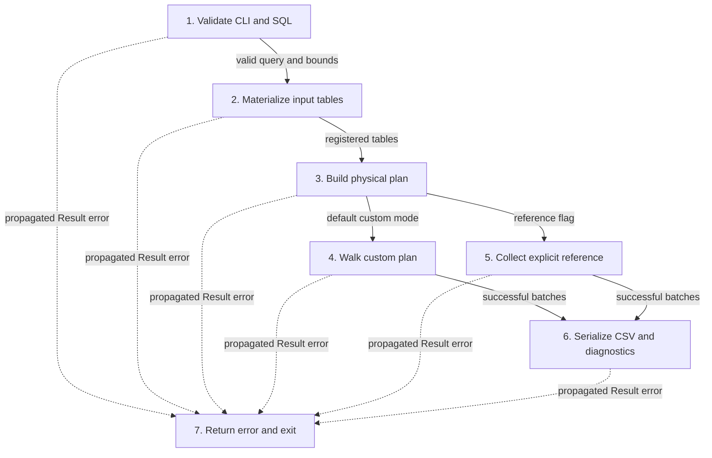
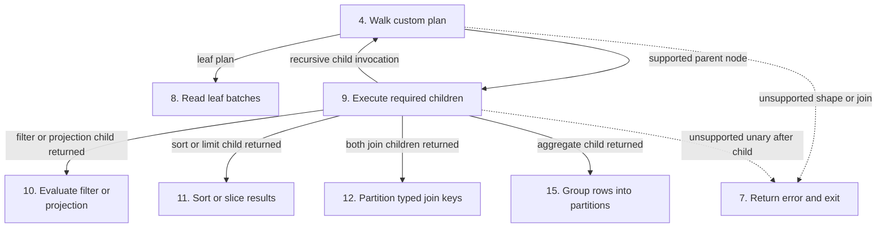
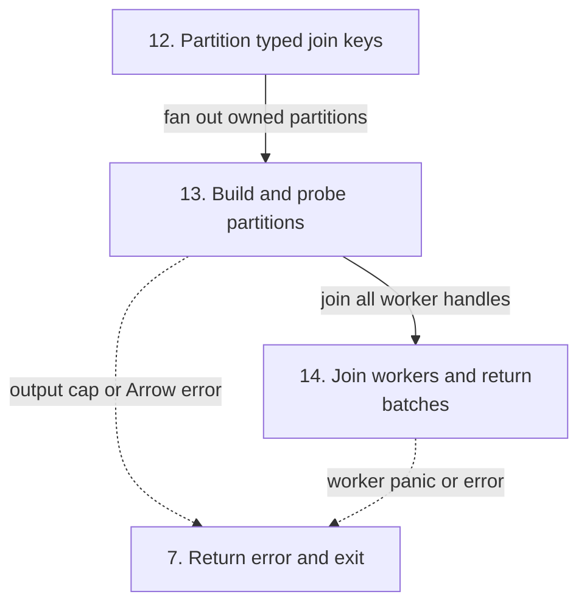
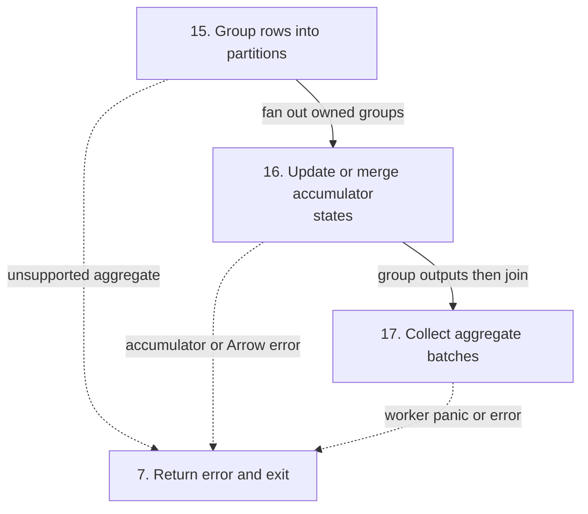
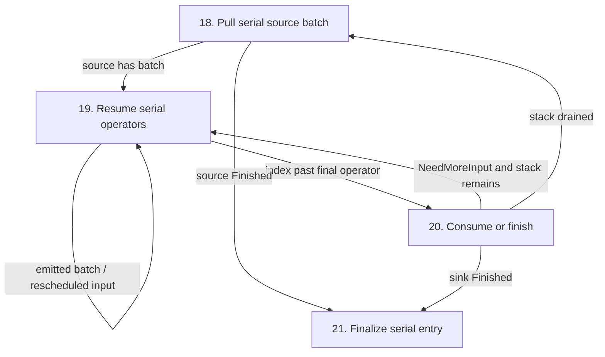
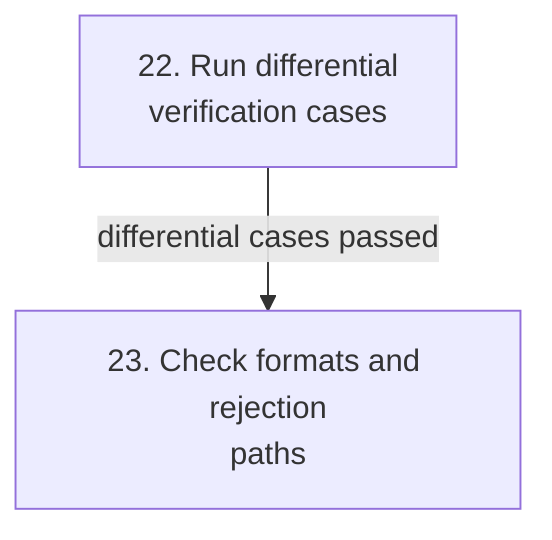
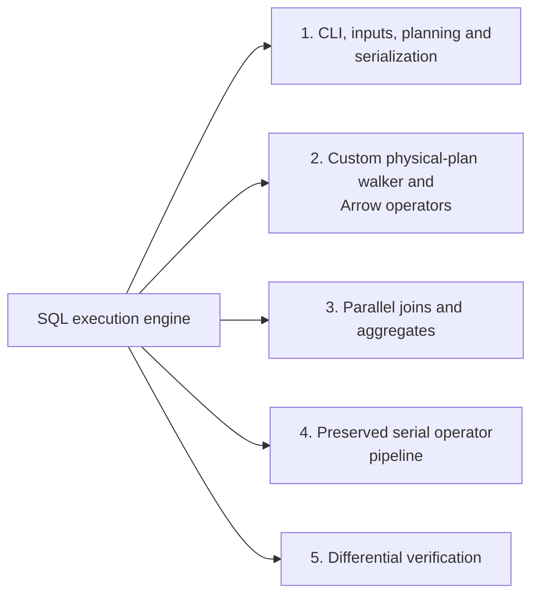
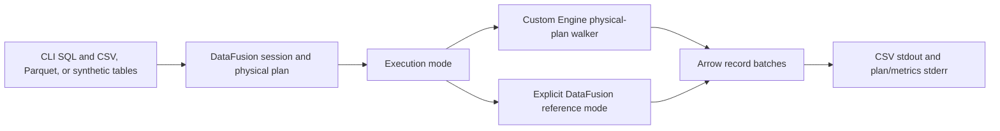
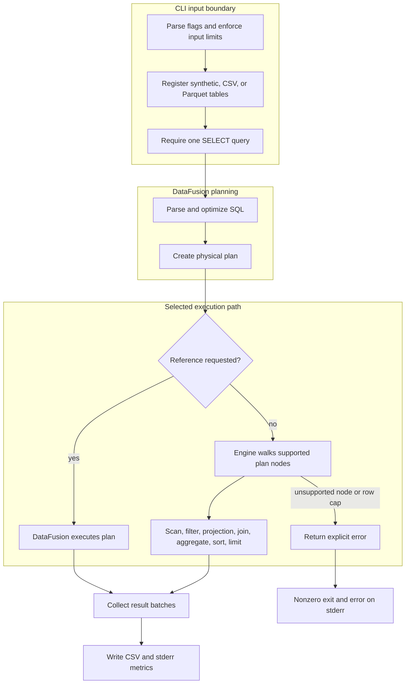

# SQL execution engine

## Contents

- [Architecture and execution guide](#architecture-and-execution-guide)
- [Run](#run)
- [Execution and limits](#execution-and-limits)
- [Implementation techniques](#implementation-techniques)
- [Verify](#verify)

This project is a bounded, noninteractive SQL runner built on the complete MIT-licensed CMU 15-721 Spring 2024 Execution Engine #2 capstone. The original Arrow operators, tests, data, and Git history remain here. This adaptation adds a usable CLI, an explicit custom physical-plan executor, exact-key joins/grouping, parallel partition workers, and differential verification. It is a portfolio adaptation, not a claim of original authorship or course completion.

Upstream is [cmu-db/15721-s24-ee2](https://github.com/cmu-db/15721-s24-ee2), baseline `4272268d129455f0e3059d27fe731748674bd3cd`, listed as Execution Engine #2 on the [official project showcase](https://15721.courses.cs.cmu.edu/spring2024/project-showcase.html). Preserve [LICENSE](LICENSE) and [README.upstream.md](README.upstream.md).

## Architecture and execution guide

<!-- execution-flow:start -->
### Execution flow

Start with the primary path, then expand a detailed workflow. Select a numbered node to see its operation, implementation techniques, and source. Solid arrows show the named control, data, or lifecycle handoff; dotted arrows show error paths. Separate entry points are named in each workflow.

CLI entry to CSV output. Custom execution is expanded below; explicit reference execution is a separate selected branch.



**Detailed workflows.** [Custom plan dispatch and operators](#flow-workflow-custom-walker) · [Partitioned inner join](#flow-workflow-parallel-join) · [Partitioned aggregate state flow](#flow-workflow-parallel-aggregate) · [Preserved serial source/operator/sink path](#flow-workflow-serial-pipeline) · [Separate differential verification driver](#flow-workflow-verification).

<a id="flow-workflow-custom-walker"></a>

<details>
<summary>Custom plan dispatch and operators</summary>

Each recursive invocation selects a physical node. Child recursion returns its batches before the parent operator runs; branch arrows do not mean every operator runs for every query.



</details>

<a id="flow-workflow-parallel-join"></a>

<details>
<summary>Partitioned inner join</summary>

The caller materializes children first. Key partitioning is serial; only owned partition build/probe work runs concurrently.



</details>

<a id="flow-workflow-parallel-aggregate"></a>

<details>
<summary>Partitioned aggregate state flow</summary>

Grouping assignment precedes scoped workers. Partial and final modes use different accumulator methods rather than identical row aggregation.



</details>

<a id="flow-workflow-serial-pipeline"></a>

<details>
<summary>Preserved serial source/operator/sink path</summary>

Independent library entry Pipeline::execute. It is not a downstream stage of the custom CLI executor.



</details>

<a id="flow-workflow-verification"></a>

<details>
<summary>Separate differential verification driver</summary>

Verification invokes the CLI modes as subprocesses. These are test actions, not a production execution stage.



</details>

#### Steps, techniques, and source

These source traces cover the active scope below. They explain implementation behavior; benchmark results and their limits remain in the measurement sections.

<a id="flow-step-validate"></a>

##### 1. Validate CLI and SQL

**Component.** CLI run. Parse flags and reject invalid bounds, missing SQL, multiple statements, and non-query statements before loading tables. Both reference flags explicitly select DataFusion execution.

**Techniques at this step.** [Decode and register bounded in-memory tables](#technique-bounded-input-materialization).

**Source.** [`src/main.rs:28`](https://github.com/STEVVVU/sql-execution-engine/blob/vectorloom/src/main.rs#L28) · [`src/main.rs:54`](https://github.com/STEVVVU/sql-execution-engine/blob/vectorloom/src/main.rs#L54) · [`src/main.rs:67`](https://github.com/STEVVVU/sql-execution-engine/blob/vectorloom/src/main.rs#L67). [Back to execution flow](#execution-flow).

<a id="flow-step-load"></a>

##### 2. Materialize input tables

**Component.** CLI / DataFusion readers. Create synthetic Arrow batches or read each bounded CSV/Parquet file with DataFusion, collect it, and register a MemTable. File-byte limits precede decoding; the custom scan applies its row bound later.

**Techniques at this step.** [Decode and register bounded in-memory tables](#technique-bounded-input-materialization).

**Source.** [`src/main.rs:91`](https://github.com/STEVVVU/sql-execution-engine/blob/vectorloom/src/main.rs#L91) · [`src/main.rs:131`](https://github.com/STEVVVU/sql-execution-engine/blob/vectorloom/src/main.rs#L131) · [`src/main.rs:143`](https://github.com/STEVVVU/sql-execution-engine/blob/vectorloom/src/main.rs#L143). [Back to execution flow](#execution-flow).

<a id="flow-step-plan"></a>

##### 3. Build physical plan

**Component.** DataFusion SessionContext. Use DataFusion SQL planning. The default configuration disables repartitioning and batch coalescing; the explicitly tuned reference uses DataFusion defaults with the requested target partitions.

**Techniques at this step.** [Delegate SQL parsing, optimization and physical planning](#technique-planner-delegation).

**Source.** [`src/main.rs:76`](https://github.com/STEVVVU/sql-execution-engine/blob/vectorloom/src/main.rs#L76) · [`src/main.rs:82`](https://github.com/STEVVVU/sql-execution-engine/blob/vectorloom/src/main.rs#L82) · [`src/main.rs:159`](https://github.com/STEVVVU/sql-execution-engine/blob/vectorloom/src/main.rs#L159). [Back to execution flow](#execution-flow).

<a id="flow-step-dispatch"></a>

##### 4. Walk custom plan

**Component.** Engine::execute. Dispatch on physical-node types and recurse into supported children. Unsupported joins are rejected before their children; an unknown unary node can execute its child before returning NotImplemented. No implicit reference fallback exists.

**Techniques at this step.** [Dispatch by physical-plan node type](#technique-plan-node-dispatch).

**Source.** [`src/engine.rs:84`](https://github.com/STEVVVU/sql-execution-engine/blob/vectorloom/src/engine.rs#L84) · [`src/engine.rs:134`](https://github.com/STEVVVU/sql-execution-engine/blob/vectorloom/src/engine.rs#L134) · [`src/engine.rs:232`](https://github.com/STEVVVU/sql-execution-engine/blob/vectorloom/src/engine.rs#L232). [Back to execution flow](#execution-flow).

<a id="flow-step-reference"></a>

##### 5. Collect explicit reference

**Component.** DataFusion collect. Only an explicit reference flag sends the physical plan to DataFusion collect. It shares the input registration and CSV serializer with custom execution.

**Techniques at this step.** [Select DataFusion as an explicit comparison oracle](#technique-explicit-reference-oracle).

**Source.** [`src/main.rs:166`](https://github.com/STEVVVU/sql-execution-engine/blob/vectorloom/src/main.rs#L166). [Back to execution flow](#execution-flow).

<a id="flow-step-serialize"></a>

##### 6. Serialize CSV and diagnostics

**Component.** CLI writer. Write the schema header and row fields; represent null as an empty CSV field. Flush output, then write mode, row count, task count, worker IDs, and diagnostic elapsed time to stderr.

**Techniques at this step.** [Serialize Arrow results as CSV rows](#technique-csv-result-serialization).

**Source.** [`src/main.rs:171`](https://github.com/STEVVVU/sql-execution-engine/blob/vectorloom/src/main.rs#L171) · [`src/main.rs:179`](https://github.com/STEVVVU/sql-execution-engine/blob/vectorloom/src/main.rs#L179) · [`src/main.rs:196`](https://github.com/STEVVVU/sql-execution-engine/blob/vectorloom/src/main.rs#L196). [Back to execution flow](#execution-flow).

<a id="flow-step-fail"></a>

##### 7. Return error and exit

**Component.** CLI main. Planning, I/O, unsupported-plan, resource-limit, Arrow, and worker errors propagate through Result. Main prints the error and exits with status 1; it does not retry with another engine.

Basic control or result handoff; the linked neighboring steps explain its implementation techniques.

**Source.** [`src/main.rs:10`](https://github.com/STEVVVU/sql-execution-engine/blob/vectorloom/src/main.rs#L10). [Back to execution flow](#execution-flow).

<a id="flow-step-scan"></a>

##### 8. Read leaf batches

**Component.** Engine::execute. Placeholder and empty plans return their defined batches. MemoryExec counts rows, rejects more than one million, then clones or projects registered Arrow batches.

**Techniques at this step.** [Enforce row caps at scan and join output](#technique-bounded-materialization) · [Evaluate expressions and transform Arrow columns](#technique-arrow-columnar-evaluation).

**Source.** [`src/engine.rs:94`](https://github.com/STEVVVU/sql-execution-engine/blob/vectorloom/src/engine.rs#L94) · [`src/engine.rs:111`](https://github.com/STEVVVU/sql-execution-engine/blob/vectorloom/src/engine.rs#L111). [Back to execution flow](#execution-flow).

<a id="flow-step-children"></a>

##### 9. Execute required children

**Component.** Engine::execute. A join executes and concatenates its left child, then its right child. Aggregates execute and concatenate their single child; coalescing nodes delegate directly. Other unary operators first execute their child.

**Techniques at this step.** [Dispatch by physical-plan node type](#technique-plan-node-dispatch) · [Enforce row caps at scan and join output](#technique-bounded-materialization).

**Source.** [`src/engine.rs:145`](https://github.com/STEVVVU/sql-execution-engine/blob/vectorloom/src/engine.rs#L145) · [`src/engine.rs:154`](https://github.com/STEVVVU/sql-execution-engine/blob/vectorloom/src/engine.rs#L154) · [`src/engine.rs:162`](https://github.com/STEVVVU/sql-execution-engine/blob/vectorloom/src/engine.rs#L162). [Back to execution flow](#execution-flow).

<a id="flow-step-unary"></a>

##### 10. Evaluate filter or projection

**Component.** Arrow physical expressions. Filters evaluate a BooleanArray and apply Arrow filtering. Projections evaluate expressions into columns and retain the input row count, including zero-column batches.

**Techniques at this step.** [Evaluate expressions and transform Arrow columns](#technique-arrow-columnar-evaluation).

**Source.** [`src/engine.rs:163`](https://github.com/STEVVVU/sql-execution-engine/blob/vectorloom/src/engine.rs#L163) · [`src/engine.rs:181`](https://github.com/STEVVVU/sql-execution-engine/blob/vectorloom/src/engine.rs#L181). [Back to execution flow](#execution-flow).

<a id="flow-step-sort-limit"></a>

##### 11. Sort or slice results

**Component.** Arrow sort / limit nodes. Sort concatenates batches, computes lexicographic row indices with the optional fetch bound, and gathers columns. Global and local limits concatenate then slice with their respective offset/fetch rules.

**Techniques at this step.** [Sort by Arrow indices and slice limits](#technique-sort-and-limit) · [Enforce row caps at scan and join output](#technique-bounded-materialization).

**Source.** [`src/engine.rs:200`](https://github.com/STEVVVU/sql-execution-engine/blob/vectorloom/src/engine.rs#L200) · [`src/engine.rs:217`](https://github.com/STEVVVU/sql-execution-engine/blob/vectorloom/src/engine.rs#L217) · [`src/engine.rs:228`](https://github.com/STEVVVU/sql-execution-engine/blob/vectorloom/src/engine.rs#L228). [Back to execution flow](#execution-flow).

<a id="flow-step-join-partition"></a>

##### 12. Partition typed join keys

**Component.** Engine::join. Evaluate both sides into typed composite ScalarValue keys. Skip a row when any key is null. Serial partition assignment uses the same ahash state on both sides; partitioning alone does not rebalance skew.

**Techniques at this step.** [Build typed composite keys with exact equality](#technique-typed-composite-keys) · [Exclude null join keys from matches](#technique-null-key-semantics) · [Partition complete keys by hash](#technique-hash-partitioning) · [Reuse ahash for partition and map hashing](#technique-ahash-hashing) · [Trade in-memory partitions for worker-local state](#technique-skew-and-memory-limits).

**Source.** [`src/engine.rs:235`](https://github.com/STEVVVU/sql-execution-engine/blob/vectorloom/src/engine.rs#L235) · [`src/engine.rs:251`](https://github.com/STEVVVU/sql-execution-engine/blob/vectorloom/src/engine.rs#L251) · [`src/engine.rs:255`](https://github.com/STEVVVU/sql-execution-engine/blob/vectorloom/src/engine.rs#L255). [Back to execution flow](#execution-flow).

<a id="flow-step-join-workers"></a>

##### 13. Build and probe partitions

**Component.** Scoped join workers. Spawn one scoped worker per partition and synchronize at a barrier. Each builds a key-to-left-row-list hash table, probes right rows with full key equality, and gathers paired Arrow rows; the shared counter rejects join output beyond one million.

**Techniques at this step.** [Build and probe partition-local hash tables](#technique-parallel-hash-join) · [Run scoped workers with a barrier and collect results](#technique-scoped-worker-execution) · [Enforce row caps at scan and join output](#technique-bounded-materialization).

**Source.** [`src/engine.rs:264`](https://github.com/STEVVVU/sql-execution-engine/blob/vectorloom/src/engine.rs#L264) · [`src/engine.rs:274`](https://github.com/STEVVVU/sql-execution-engine/blob/vectorloom/src/engine.rs#L274) · [`src/engine.rs:285`](https://github.com/STEVVVU/sql-execution-engine/blob/vectorloom/src/engine.rs#L285). [Back to execution flow](#execution-flow).

<a id="flow-step-join-collect"></a>

##### 14. Join workers and return batches

**Component.** Engine::join / record. Join all handles, translate a worker panic into an execution error, propagate worker errors, and record successful task IDs before returning batches.

**Techniques at this step.** [Run scoped workers with a barrier and collect results](#technique-scoped-worker-execution).

**Source.** [`src/engine.rs:306`](https://github.com/STEVVVU/sql-execution-engine/blob/vectorloom/src/engine.rs#L306) · [`src/engine.rs:316`](https://github.com/STEVVVU/sql-execution-engine/blob/vectorloom/src/engine.rs#L316). [Back to execution flow](#execution-flow).

<a id="flow-step-aggregate-partition"></a>

##### 15. Group rows into partitions

**Component.** Engine::aggregate. Reject ordered aggregates, FILTER, and grouping sets. Partition complete typed group keys to row lists using ahash; insert one empty global group when there are no input rows and no grouping expressions.

**Techniques at this step.** [Build typed composite keys with exact equality](#technique-typed-composite-keys) · [Partition complete keys by hash](#technique-hash-partitioning) · [Reuse ahash for partition and map hashing](#technique-ahash-hashing) · [Trade in-memory partitions for worker-local state](#technique-skew-and-memory-limits).

**Source.** [`src/engine.rs:326`](https://github.com/STEVVVU/sql-execution-engine/blob/vectorloom/src/engine.rs#L326) · [`src/engine.rs:350`](https://github.com/STEVVVU/sql-execution-engine/blob/vectorloom/src/engine.rs#L350) · [`src/engine.rs:362`](https://github.com/STEVVVU/sql-execution-engine/blob/vectorloom/src/engine.rs#L362). [Back to execution flow](#execution-flow).

<a id="flow-step-aggregate-workers"></a>

##### 16. Update or merge accumulator states

**Component.** Scoped aggregate workers. After the barrier, gather each group and create DataFusion accumulators. Final modes merge serialized state columns; other modes update from expression inputs. Partial mode emits states, while other modes evaluate final values.

**Techniques at this step.** [Update and merge aggregate accumulator states](#technique-partial-aggregate-states) · [Run scoped workers with a barrier and collect results](#technique-scoped-worker-execution) · [Evaluate expressions and transform Arrow columns](#technique-arrow-columnar-evaluation).

**Source.** [`src/engine.rs:365`](https://github.com/STEVVVU/sql-execution-engine/blob/vectorloom/src/engine.rs#L365) · [`src/engine.rs:378`](https://github.com/STEVVVU/sql-execution-engine/blob/vectorloom/src/engine.rs#L378) · [`src/engine.rs:393`](https://github.com/STEVVVU/sql-execution-engine/blob/vectorloom/src/engine.rs#L393). [Back to execution flow](#execution-flow).

<a id="flow-step-aggregate-collect"></a>

##### 17. Collect aggregate batches

**Component.** Engine::aggregate / record. Convert group rows to Arrow batches, join scoped worker handles, propagate errors, and record worker IDs. There is no spill-to-disk path.

**Techniques at this step.** [Run scoped workers with a barrier and collect results](#technique-scoped-worker-execution) · [Enforce row caps at scan and join output](#technique-bounded-materialization).

**Source.** [`src/engine.rs:409`](https://github.com/STEVVVU/sql-execution-engine/blob/vectorloom/src/engine.rs#L409) · [`src/engine.rs:415`](https://github.com/STEVVVU/sql-execution-engine/blob/vectorloom/src/engine.rs#L415) · [`src/engine.rs:316`](https://github.com/STEVVVU/sql-execution-engine/blob/vectorloom/src/engine.rs#L316). [Back to execution flow](#execution-flow).

<a id="flow-step-pipeline-source"></a>

##### 18. Pull serial source batch

**Component.** Preserved Pipeline::execute. This independent library pipeline pulls from its source and pushes operator index zero onto a local stack. The custom CLI executor does not call this pipeline.

**Techniques at this step.** [Reschedule serial pipeline batches with an explicit stack](#technique-serial-pipeline-rescheduling).

**Source.** [`src/parallel/pipeline.rs:48`](https://github.com/STEVVVU/sql-execution-engine/blob/vectorloom/src/parallel/pipeline.rs#L48) · [`src/parallel/pipeline.rs:56`](https://github.com/STEVVVU/sql-execution-engine/blob/vectorloom/src/parallel/pipeline.rs#L56). [Back to execution flow](#execution-flow).

<a id="flow-step-pipeline-operator"></a>

##### 19. Resume serial operators

**Component.** Preserved Pipeline stack. Pop work from the local stack. HaveMoreOutput requeues the current operator/input and schedules the emitted batch at the next index; Finished only schedules the emitted batch at the next index.

**Techniques at this step.** [Reschedule serial pipeline batches with an explicit stack](#technique-serial-pipeline-rescheduling).

**Source.** [`src/parallel/pipeline.rs:70`](https://github.com/STEVVVU/sql-execution-engine/blob/vectorloom/src/parallel/pipeline.rs#L70) · [`src/parallel/pipeline.rs:86`](https://github.com/STEVVVU/sql-execution-engine/blob/vectorloom/src/parallel/pipeline.rs#L86). [Back to execution flow](#execution-flow).

<a id="flow-step-pipeline-sink"></a>

##### 20. Consume or finish

**Component.** Preserved Sink. When the index passes the operators, call sink. NeedMoreInput continues stack work; Finished exits the outer source loop. A finished source also exits that loop.

**Techniques at this step.** [Reschedule serial pipeline batches with an explicit stack](#technique-serial-pipeline-rescheduling).

**Source.** [`src/parallel/pipeline.rs:64`](https://github.com/STEVVVU/sql-execution-engine/blob/vectorloom/src/parallel/pipeline.rs#L64) · [`src/parallel/pipeline.rs:77`](https://github.com/STEVVVU/sql-execution-engine/blob/vectorloom/src/parallel/pipeline.rs#L77). [Back to execution flow](#execution-flow).

<a id="flow-step-pipeline-finalize"></a>

##### 21. Finalize serial entry

**Component.** Preserved Pipeline store. After the loop, finalize the sink and insert its entry into the shared RefCell-backed store. This is serial scheduling, despite the module directory name.

**Techniques at this step.** [Reschedule serial pipeline batches with an explicit stack](#technique-serial-pipeline-rescheduling).

**Source.** [`src/parallel/pipeline.rs:107`](https://github.com/STEVVVU/sql-execution-engine/blob/vectorloom/src/parallel/pipeline.rs#L107). [Back to execution flow](#execution-flow).

<a id="flow-step-verify-cases"></a>

##### 22. Run differential verification cases

**Component.** scripts/verify.ps1. The separate verification driver runs library tests, requires the built CLI, and invokes custom, reference, and tuned-reference modes for empty and nonempty fixtures. It compares exact CSV output and fails on nonzero exits or mismatches.

**Techniques at this step.** [Select DataFusion as an explicit comparison oracle](#technique-explicit-reference-oracle).

**Source.** [`scripts/verify.ps1:6`](https://github.com/STEVVVU/sql-execution-engine/blob/vectorloom/scripts/verify.ps1#L6) · [`scripts/verify.ps1:24`](https://github.com/STEVVVU/sql-execution-engine/blob/vectorloom/scripts/verify.ps1#L24) · [`scripts/verify.ps1:33`](https://github.com/STEVVVU/sql-execution-engine/blob/vectorloom/scripts/verify.ps1#L33). [Back to execution flow](#execution-flow).

<a id="flow-step-verify-boundaries"></a>

##### 23. Check formats and rejection paths

**Component.** scripts/verify.ps1. Check Parquet and CSV aggregates, invalid worker counts, and unsupported outer joins. Remove the scratch CSV fixture while retaining logs and result evidence. This describes the driver, not a newly executed test result.

**Techniques at this step.** [Select DataFusion as an explicit comparison oracle](#technique-explicit-reference-oracle).

**Source.** [`scripts/verify.ps1:39`](https://github.com/STEVVVU/sql-execution-engine/blob/vectorloom/scripts/verify.ps1#L39) · [`scripts/verify.ps1:50`](https://github.com/STEVVVU/sql-execution-engine/blob/vectorloom/scripts/verify.ps1#L50) · [`scripts/verify.ps1:55`](https://github.com/STEVVVU/sql-execution-engine/blob/vectorloom/scripts/verify.ps1#L55). [Back to execution flow](#execution-flow).

<details>
<summary>Scope and subsystem coverage</summary>

Active CLI and custom executor in src/main.rs and src/engine.rs, plus the preserved serial source/operator/sink pipeline in src/parallel/pipeline.rs. DataFusion planning, Arrow expression and batch primitives, CSV/Parquet readers, reference execution, ahash selection, and verify driver are documented only where directly invoked by these paths.

- **CLI, inputs, planning and serialization.** Covered by the named execution steps and their source references; independent library and verification entry points remain separate. [Step 1](#flow-step-validate), [Step 2](#flow-step-load), [Step 3](#flow-step-plan), [Step 5](#flow-step-reference), [Step 6](#flow-step-serialize), [Step 7](#flow-step-fail).
- **Custom physical-plan walker and Arrow operators.** Covered by the named execution steps and their source references; independent library and verification entry points remain separate. [Step 4](#flow-step-dispatch), [Step 8](#flow-step-scan), [Step 9](#flow-step-children), [Step 10](#flow-step-unary), [Step 11](#flow-step-sort-limit).
- **Parallel joins and aggregates.** Covered by the named execution steps and their source references; independent library and verification entry points remain separate. [Step 12](#flow-step-join-partition), [Step 13](#flow-step-join-workers), [Step 14](#flow-step-join-collect), [Step 15](#flow-step-aggregate-partition), [Step 16](#flow-step-aggregate-workers), [Step 17](#flow-step-aggregate-collect).
- **Preserved serial operator pipeline.** Covered by the named execution steps and their source references; independent library and verification entry points remain separate. [Step 18](#flow-step-pipeline-source), [Step 19](#flow-step-pipeline-operator), [Step 20](#flow-step-pipeline-sink), [Step 21](#flow-step-pipeline-finalize).
- **Differential verification.** Covered by the named execution steps and their source references; independent library and verification entry points remain separate. [Step 22](#flow-step-verify-cases), [Step 23](#flow-step-verify-boundaries).

Outside this flow audit:

- `other preserved operators and experiments`. Only the CLI executor and directly documented serial pipeline are within the audited active scope.

</details>

<!-- execution-flow:end -->

<details>
<summary>Subsystem technique index</summary>

### Subsystem map

Select a subsystem in the diagram to open its techniques, tradeoffs, and code references. The numbered links provide the same navigation. This map groups components; the execution diagrams show their runtime flow.



1. [CLI, inputs, planning and serialization](#subsystem-cli-inputs-planning-and-serialization)
2. [Custom physical-plan walker and Arrow operators](#subsystem-custom-physical-plan-walker-and-arrow-operators)
3. [Parallel joins and aggregates](#subsystem-parallel-joins-and-aggregates)
4. [Preserved serial operator pipeline](#subsystem-preserved-serial-operator-pipeline)
5. [Differential verification](#subsystem-differential-verification)

The inherited CMU capstone supplies Arrow operators, tests, and the original serial pipeline. DataFusion supplies SQL parsing, optimization, physical planning, expressions, CSV and Parquet decoding, and the explicit reference executor. The added CLI registers input tables and uses the custom owned executor by default or the explicitly requested DataFusion reference path. The preserved serial pipeline remains a separate library path. The custom executor does not silently fall back for unsupported nodes.

This boundary map shows the CLI, DataFusion planning boundary, and the two explicitly selectable execution paths.

</details>

<details>
<summary>Expand flow diagram 1</summary>



</details>

The DataFusion planner creates the physical plan for both modes. In custom mode, `Engine` recognizes supported nodes and executes operators over Arrow record batches. In reference mode, DataFusion executes the planned query. The upstream `Pipeline` remains a separate serial path used by preserved library code; it is not the custom parallel executor.

This flow shows table registration, plan validation, custom execution, and the explicit unsupported-plan error boundary.

<details>
<summary>Expand flow diagram 2</summary>



</details>

Hash joins and grouped aggregates in the custom engine partition complete keys across owned workers. A barrier joins worker tasks before output collection. Row caps apply to the custom path; the reference path is an explicit verification oracle and bypasses those custom caps. CSV represents both null and empty string as an empty field.

| Subsystem | Responsibility | Owned state or invariant | Source |
| --- | --- | --- | --- |
| CLI and table registration | Validate flags and register synthetic, CSV, and Parquet inputs | One SELECT statement; bounded SQL, input, worker, and batch settings | [`src/main.rs`](src/main.rs) |
| DataFusion planner | Parse and optimize SQL into a physical plan | Plan node types determine whether custom execution is supported | [`src/main.rs`](src/main.rs) |
| Custom plan walker | Execute supported physical nodes and reject unknown nodes | One-million-row scan/output cap; no implicit fallback | [`src/engine.rs`](src/engine.rs) |
| Parallel join and aggregate | Partition complete keys, execute workers, merge Arrow output | Worker range 1..32; key equality remains exact after hashing | [`src/engine.rs`](src/engine.rs) |
| Preserved operator pipeline | Run inherited source, intermediate operators, and sink serially | Pipeline-local operators and intermediate result store | [`src/parallel/pipeline.rs`](src/parallel/pipeline.rs) |
| Differential driver | Compare custom CLI output with explicit reference output | Exact CSV comparisons and preserved feature evidence | [`scripts/verify.ps1`](scripts/verify.ps1) |

Terms used in query execution: [physical plan](#concept-physical-plan), [record batch](#concept-record-batch), [Arrow](#concept-arrow), [hash join](#concept-hash-join), [aggregate state](#concept-aggregate-state), [owned partition](#concept-owned-partition), [differential execution](#concept-differential-execution), and [spill](#concept-spill).

### Follow one query

1. Choose an input registration such as `--synthetic 35`, `--csv items=items.csv`, or `--parquet products=data/products.parquet`.
2. The CLI validates worker count, batch size, SQL length, and that the input contains exactly one SELECT statement.
3. DataFusion registers table schemas, parses and optimizes the SQL, and builds a physical plan.
4. By default, `Engine` walks the plan. It executes supported scans, filters, projections, inner equijoins, aggregates, sorts, and limits. It returns an explicit error for an unsupported node.
5. For join and aggregate work, the engine hashes full scalar keys into worker partitions, runs scoped worker tasks, and combines their Arrow batches. Hash collisions do not replace equality checks.
6. The CLI writes result rows as CSV to stdout and the plan plus diagnostic metrics to stderr. Use `--reference` only when you want DataFusion's executor as a comparison path.

### Design decisions and limits

These rationales are inferred from the current implementation. They do not record historic design intent.

| Choice | Practical rationale | Alternative and cost | Reconsider when |
| --- | --- | --- | --- |
| Let DataFusion parse, optimize, and plan | Reuses established SQL and Arrow expression handling while the project focuses on execution | A custom parser and optimizer would broaden scope and duplicate mature behavior | The project needs to study planning itself |
| Walk the physical plan explicitly | Makes supported execution behavior visible and fails clearly on unsupported nodes | Implicit fallback is more compatible but can hide which engine ran | The supported set grows and a deliberate dispatch design changes |
| Keep the original serial pipeline and owned executor separate | Avoids sharing its `RefCell` state across worker threads | Refactoring both into one abstraction would change preserved upstream structure | The serial path is removed or its state becomes safely shareable |
| Partition complete join and aggregate keys | Keeps all rows for one key together and allows independent worker state | Streaming or shared concurrent maps may reduce memory but add synchronization and skew costs | Memory limits or skew dominate a measured use case |
| Keep reference execution explicit | Makes differential checks intentional and preserves custom-plan errors | Automatic fallback hides unsupported behavior and comparison mode | A production compatibility contract requires fallback semantics |

### Glossary

<a id="concept-physical-plan"></a>

<details><summary>What is a physical plan?</summary>

A physical plan is the executable operator tree produced after SQL planning. The custom engine supports a bounded set of DataFusion node types and reports an error for others.
</details>

<a id="concept-record-batch"></a>

<details><summary>What is a record batch?</summary>

A record batch is a columnar group of rows with an Arrow schema. The custom executor passes batches between scan, filter, projection, and output collection steps.
</details>

<a id="concept-arrow"></a>

<details><summary>What is Arrow?</summary>

Arrow is a columnar memory format and compute library. This engine stores intermediate table data in Arrow record batches and uses Arrow compute operations for filters, sorting, and row selection.
</details>

<a id="concept-hash-join"></a>

<details><summary>What is a hash join?</summary>

A hash join builds a lookup structure from join keys, then probes it with keys from the other input. Here the custom path supports inner equijoins without residual filters and checks exact key equality after hashing.
</details>

<a id="concept-aggregate-state"></a>

<details><summary>What is aggregate state?</summary>

Aggregate state holds partial values such as a sum or count while rows are grouped. Workers update independent Arrow accumulators, then combine partial states for supported aggregates.
</details>

<a id="concept-owned-partition"></a>

<details><summary>What is an owned partition?</summary>

An owned partition is the worker's exclusive subset of keys and rows for a parallel operator. Complete join or group keys are assigned to one partition so workers do not update shared mutable maps.
</details>

<a id="concept-differential-execution"></a>

<details><summary>What is differential execution?</summary>

Differential execution runs the same query through two implementations and compares results. The CLI's explicit `--reference` mode uses DataFusion as the comparison path for the custom executor.
</details>

<a id="concept-spill"></a>

<details><summary>What is spill?</summary>

Spill writes intermediate data to disk when memory limits are reached. This engine is in-memory and does not spill; custom scanned tables and outputs are capped at one million rows.
</details>

## Implementation techniques

This section covers the active CLI executor and the preserved serial pipeline. Historical operator implementations not invoked by the CLI are outside this technique map. Rationale describes current fit and is inferred from code.

<details>
<summary>Full technique index</summary>

| Active subsystem | Technique cards | Code |
| --- | --- | --- |
| CLI, inputs, planning and serialization | [Planner delegation](#technique-planner-delegation), [bounded table materialization](#technique-bounded-input-materialization), [CSV output](#technique-csv-result-serialization), [explicit reference oracle](#technique-explicit-reference-oracle) | [`src/main.rs`](src/main.rs) |
| Custom plan walker and Arrow operators | [Physical-plan dispatch](#technique-plan-node-dispatch), [Arrow columnar evaluation](#technique-arrow-columnar-evaluation), [row caps](#technique-bounded-materialization), [sort and limit](#technique-sort-and-limit) | [`src/engine.rs`](src/engine.rs) |
| Parallel joins and aggregates | [Typed keys](#technique-typed-composite-keys), [hash partitioning](#technique-hash-partitioning), [partition-local hash join](#technique-parallel-hash-join), [null join keys](#technique-null-key-semantics), [scoped workers](#technique-scoped-worker-execution), [partial aggregate states](#technique-partial-aggregate-states), [ahash](#technique-ahash-hashing), [memory and skew limits](#technique-skew-and-memory-limits) | [`src/engine.rs`](src/engine.rs), [`Cargo.toml`](Cargo.toml) |
| Preserved operator pipeline | [Stack-based serial rescheduling](#technique-serial-pipeline-rescheduling) | [`src/parallel/pipeline.rs`](src/parallel/pipeline.rs) |
| Differential verification | [Explicit reference oracle](#technique-explicit-reference-oracle) | [`scripts/verify.ps1`](scripts/verify.ps1), [`src/main.rs`](src/main.rs) |

</details>

<a id="subsystem-cli-inputs-planning-and-serialization"></a>

### 1. CLI, inputs, planning and serialization

[Back to the subsystem map](#architecture-and-execution-guide).

**Code.** [`src/main.rs`](src/main.rs).

**Techniques.** [Delegate SQL parsing, optimization and physical planning](#technique-planner-delegation), [Decode and register bounded in-memory tables](#technique-bounded-input-materialization), [Serialize Arrow results as CSV rows](#technique-csv-result-serialization), [Select DataFusion as an explicit comparison oracle](#technique-explicit-reference-oracle).

**Related concepts.** [physical plan](#concept-physical-plan), [Arrow](#concept-arrow), [spill](#concept-spill).

#### Planner delegation

<a id="technique-planner-delegation"></a>

<details>
<summary>Delegate SQL parsing, optimization and physical planning</summary>

**Mechanism.** The CLI sends the validated query to DataFusion, which parses and optimizes SQL and creates a physical plan. The same plan goes to either the custom walker or DataFusion’s executor when reference mode is explicitly selected.

**Example.** `ctx.sql(&sql).await?.create_physical_plan().await?` supplies the plan consumed by both branches.

**Why here.** This lets the adaptation focus on execution while reusing DataFusion’s SQL and expression machinery. This rationale is inferred from the current boundary.

**Tradeoffs.** Planning behavior and physical node types come from DataFusion 36. The custom executor must reject plan nodes it does not handle; it does not transparently inherit all DataFusion operators.

**Code and ownership.** [`src/main.rs`](src/main.rs#L159), dependency supplied.


**Used in.** [CLI, inputs, planning and serialization](#subsystem-cli-inputs-planning-and-serialization). [Back to the subsystem map](#architecture-and-execution-guide).

</details>

#### Bounded input materialization

<a id="technique-bounded-input-materialization"></a>

<details>
<summary>Decode and register bounded in-memory tables</summary>

**Mechanism.** CSV and Parquet are decoded by DataFusion readers, collected into Arrow batches, and registered as a `MemTable`. File bytes are capped before decoding; the custom executor later caps scanned rows. Synthetic tables are generated in batches of the requested size.

**Example.** `--csv items=items.csv` reads the file, collects its batches, and registers `items` for planning.

**Why here.** One in-memory representation feeds both the custom executor and reference executor.

**Tradeoffs.** The file-size check does not bound decoded memory exactly, and input decoding precedes the custom row cap. There is no streaming scan or spill path.

**Code and ownership.** [`src/main.rs`](src/main.rs#L90), [`src/main.rs`](src/main.rs#L134), mixed CLI and DataFusion readers.


**Used in.** [CLI, inputs, planning and serialization](#subsystem-cli-inputs-planning-and-serialization). [Back to the subsystem map](#architecture-and-execution-guide).

</details>

#### CSV result serialization

<a id="technique-csv-result-serialization"></a>

<details>
<summary>Serialize Arrow results as CSV rows</summary>

**Mechanism.** The CLI writes schema field names, visits each row and column, converts each value through `ScalarValue`, maps null to an empty string, and passes fields to the CSV writer. The writer handles CSV quoting and flushes stdout.

**Example.** A null and an empty string both appear as an empty field in the emitted CSV.

**Why here.** CSV gives the command-line runner a consumable text result while metrics and the plan remain on stderr.

**Tradeoffs.** The text representation is not type-preserving, and null is ambiguous with empty text. This output is for inspection and differential comparison, not a typed interchange format.

**Code and ownership.** [`src/main.rs`](src/main.rs#L171), mixed project conversion and csv crate writer.


**Used in.** [CLI, inputs, planning and serialization](#subsystem-cli-inputs-planning-and-serialization). [Back to the subsystem map](#architecture-and-execution-guide).

</details>

#### Explicit reference oracle

<a id="technique-explicit-reference-oracle"></a>

<details>
<summary>Select DataFusion as an explicit comparison oracle</summary>

**Mechanism.** `--reference` sends the same physical plan to DataFusion’s `collect`; default mode sends it to `Engine::execute`. The verification script runs custom, reference, and tuned-reference commands and compares emitted CSV text for its fixtures.

**Example.** The driver compares exact file contents after each custom and reference run for empty and multibatch synthetic inputs.

**Why here.** An explicit second execution path makes supported query results comparable without hiding custom unsupported-plan errors.

**Tradeoffs.** CLI CSV comparison can conflate null and empty string, and ordering is only comparable when the query specifies it. Reference execution bypasses custom row caps; it is not proof of all-query equivalence.

**Code and ownership.** [`src/main.rs`](src/main.rs#L166), [`scripts/verify.ps1`](scripts/verify.ps1#L24), mixed project selection and DataFusion executor.


**Used in.** [CLI, inputs, planning and serialization](#subsystem-cli-inputs-planning-and-serialization), [Differential verification](#subsystem-differential-verification). [Back to the subsystem map](#architecture-and-execution-guide).

</details>

<a id="subsystem-custom-physical-plan-walker-and-arrow-operators"></a>

### 2. Custom physical-plan walker and Arrow operators

[Back to the subsystem map](#architecture-and-execution-guide).

**Code.** [`src/engine.rs`](src/engine.rs).

**Techniques.** [Dispatch by physical-plan node type](#technique-plan-node-dispatch), [Evaluate expressions and transform Arrow columns](#technique-arrow-columnar-evaluation), [Sort by Arrow indices and slice limits](#technique-sort-and-limit), [Enforce row caps at scan and join output](#technique-bounded-materialization).

**Related concepts.** [Arrow](#concept-arrow).

#### Physical-plan dispatch

<a id="technique-plan-node-dispatch"></a>

<details>
<summary>Dispatch by physical-plan node type</summary>

**Mechanism.** `Engine::execute` inspects each DataFusion node with type checks and downcasts, recursively executes child plans, and handles the supported scans, filters, projections, joins, aggregates, sorts, and limits. Unknown shapes return `NotImplemented` rather than falling through to another engine.

**Example.** A `HashJoinExec` is accepted only for an inner equijoin with no residual filter and SQL null semantics.

**Why here.** Explicit dispatch makes this executor’s support boundary observable and keeps the reference path intentional.

**Tradeoffs.** New DataFusion plan shapes require an explicit implementation. Multi-input unknown nodes fail rather than being guessed.

**Code and ownership.** [`src/engine.rs`](src/engine.rs#L84), extension over DataFusion plan types.


**Used in.** [Custom physical-plan walker and Arrow operators](#subsystem-custom-physical-plan-walker-and-arrow-operators). [Back to the subsystem map](#architecture-and-execution-guide).

</details>

#### Arrow columnar evaluation

<a id="technique-arrow-columnar-evaluation"></a>

<details>
<summary>Evaluate expressions and transform Arrow columns</summary>

**Mechanism.** Physical expressions evaluate against a `RecordBatch` into arrays. Filters apply a BooleanArray mask to whole batches; projections evaluate each expression into output columns and construct a schema-matched batch. Arrow owns the columnar compute primitives.

**Example.** A `WHERE value >= 10` predicate is evaluated once for the batch and passed to `filter_record_batch`.

**Why here.** Batches preserve Arrow’s typed column representation across the custom operators.

**Tradeoffs.** The filter path requires a BooleanArray predicate, and projection builds a new batch. The custom code does not add fused filter-projection execution.

**Code and ownership.** [`src/engine.rs`](src/engine.rs#L38), [`src/engine.rs`](src/engine.rs#L161), [`src/engine.rs`](src/engine.rs#L181), mixed project dispatch and Arrow evaluation.


**Used in.** [Custom physical-plan walker and Arrow operators](#subsystem-custom-physical-plan-walker-and-arrow-operators). [Back to the subsystem map](#architecture-and-execution-guide).

</details>

#### Sort and limit

<a id="technique-sort-and-limit"></a>

<details>
<summary>Sort by Arrow indices and slice limits</summary>

**Mechanism.** The sort branch concatenates child batches, evaluates DataFusion sort expressions into sort columns, obtains lexicographic row indices, and applies those indices to each column. Global limit applies skip and fetch by slicing the batch; local limit slices from row zero.

**Example.** `ORDER BY value DESC LIMIT 3` produces sorted indices and the upper plan’s limit keeps the requested prefix.

**Why here.** Arrow’s sort and take operators preserve typed columns without rebuilding rows one value at a time.

**Tradeoffs.** Sorting collects all child rows before ordering, and the custom path does not implement a streaming top-k algorithm.

**Code and ownership.** [`src/engine.rs`](src/engine.rs#L200), [`src/engine.rs`](src/engine.rs#L217), mixed project dispatch and Arrow compute.


**Used in.** [Custom physical-plan walker and Arrow operators](#subsystem-custom-physical-plan-walker-and-arrow-operators). [Back to the subsystem map](#architecture-and-execution-guide).

</details>

#### Row caps

<a id="technique-bounded-materialization"></a>

<details>
<summary>Reject oversized scans and join results</summary>

**Mechanism.** Before returning a `MemoryExec` scan, the executor sums rows across all partitions and rejects input above `MAX_ROWS`. During join output gathering, workers increment a shared atomic counter for each match and return `ResourcesExhausted` once the cap is crossed.

**Example.** A scan above one million rows fails before its batches are returned; a many-to-many join can independently hit the same cap through its emitted matches.

**Why here.** These checks make row-count limits explicit at custom scan and join output boundaries.

**Tradeoffs.** The cap is row-based and does not account for row width or total allocated bytes. It applies to custom execution; explicit reference execution does not use this guard.

**Code and ownership.** [`src/engine.rs`](src/engine.rs#L21), [`src/engine.rs`](src/engine.rs#L111), [`src/engine.rs`](src/engine.rs#L281), extension.


**Used in.** [Custom physical-plan walker and Arrow operators](#subsystem-custom-physical-plan-walker-and-arrow-operators). [Back to the subsystem map](#architecture-and-execution-guide).

</details>

<a id="subsystem-parallel-joins-and-aggregates"></a>

### 3. Parallel joins and aggregates

[Back to the subsystem map](#architecture-and-execution-guide).

**Code.** [`src/engine.rs`](src/engine.rs), [`Cargo.toml`](Cargo.toml).

**Techniques.** [Build typed composite keys with exact equality](#technique-typed-composite-keys), [Partition complete keys by hash](#technique-hash-partitioning), [Build and probe partition-local hash tables](#technique-parallel-hash-join), [Exclude null join keys from matches](#technique-null-key-semantics), [Run scoped workers with a barrier and collect results](#technique-scoped-worker-execution), [Update and merge aggregate accumulator states](#technique-partial-aggregate-states), [Reuse ahash for partition and map hashing](#technique-ahash-hashing), [Trade in-memory partitions for worker-local state](#technique-skew-and-memory-limits).

**Related concepts.** [physical plan](#concept-physical-plan), [Arrow](#concept-arrow), [spill](#concept-spill).

#### Typed composite keys

<a id="technique-typed-composite-keys"></a>

<details>
<summary>Build typed composite keys with exact equality</summary>

**Mechanism.** Each key expression is evaluated to an Arrow array, and each row’s values are extracted into an ordered `Vec<ScalarValue>`. The whole vector serves as the hash-map key, so all key columns and their scalar types participate in equality.

**Example.** For `ON l.id=r.id AND l.category=r.category`, the key is a pair such as `[Int64(7), Utf8("a")]` on each side.

**Why here.** The key representation directly matches DataFusion’s typed scalar values and handles multiple join or grouping expressions.

**Tradeoffs.** Extracting scalar values materializes per-row keys and hashes them repeatedly. Hash collisions still require full key equality; a hash value alone never establishes a match.

**Code and ownership.** [`src/engine.rs`](src/engine.rs#L20), [`src/engine.rs`](src/engine.rs#L45), mixed Arrow scalar extraction and project key shape.


**Used in.** [Parallel joins and aggregates](#subsystem-parallel-joins-and-aggregates). [Back to the subsystem map](#architecture-and-execution-guide).

</details>

#### Hash partitioning

<a id="technique-hash-partitioning"></a>

<details>
<summary>Partition complete keys by hash</summary>

**Mechanism.** The engine hashes each complete scalar key and maps the result to a worker slot with modulo worker count. Join build and probe rows use the same hasher and mapping; aggregate rows use it to choose a group map. Equal keys are routed together within each operator.

**Example.** `partition(&key, workers, &hash_state)` selects the vector receiving a join row or aggregate key.

**Why here.** Worker-local maps avoid shared mutable hash tables for the partitioned operator work.

**Tradeoffs.** Partition assignment is serial before threads start, and uneven key frequencies can concentrate work in a few partitions. Modulo routing is not a skew remedy.

**Code and ownership.** [`src/engine.rs`](src/engine.rs#L52), [`src/engine.rs`](src/engine.rs#L249), [`src/engine.rs`](src/engine.rs#L351), extension.


**Used in.** [Parallel joins and aggregates](#subsystem-parallel-joins-and-aggregates). [Back to the subsystem map](#architecture-and-execution-guide).

</details>

#### Partition-local hash join

<a id="technique-parallel-hash-join"></a>

<details>
<summary>Build and probe partition-local hash tables</summary>

**Mechanism.** Each worker builds a `HashMap<Key, Vec<row index>>` from its left partition, probes with the matching right partition, and gathers paired row indices. Arrow `take` materializes the matched rows, then the engine combines left and right columns into an output batch.

**Example.** Duplicate left keys retain multiple indices in the map, so one right row emits a row pair for each left match.

**Why here.** Complete-key partitioning allows independent build/probe maps and preserves duplicate matches.

**Tradeoffs.** Inputs are concatenated and partition vectors, maps, indices, and output batches are held in memory. There is no spill or streaming join.

**Code and ownership.** [`src/engine.rs`](src/engine.rs#L238), project implementation using Arrow and Rust maps.


**Used in.** [Parallel joins and aggregates](#subsystem-parallel-joins-and-aggregates). [Back to the subsystem map](#architecture-and-execution-guide).

</details>

#### Null join keys

<a id="technique-null-key-semantics"></a>

<details>
<summary>Exclude null join keys from matches</summary>

**Mechanism.** The dispatcher rejects `null_equals_null` joins. During routing, any composite join key containing a null scalar is skipped on both sides, so it can never enter a build or probe partition.

**Example.** A row with `(id = NULL, category = "a")` contributes no join candidate, even if the other table has the same null-containing tuple.

**Why here.** This implements ordinary SQL equijoin null behavior for the supported join form.

**Tradeoffs.** Null-safe equality is explicitly unsupported. Group-by keys use a separate path and are not dropped by this join rule.

**Code and ownership.** [`src/engine.rs`](src/engine.rs#L134), [`src/engine.rs`](src/engine.rs#L256), extension.


**Used in.** [Parallel joins and aggregates](#subsystem-parallel-joins-and-aggregates). [Back to the subsystem map](#architecture-and-execution-guide).

</details>

#### Scoped worker execution

<a id="technique-scoped-worker-execution"></a>

<details>
<summary>Run scoped workers with a barrier and collect results</summary>

**Mechanism.** `thread::scope` launches one task per partition; a shared barrier makes the tasks rendezvous before local work. Scoped borrowing lets workers use input batches without transferring ownership beyond the call. Handles are joined, worker panics become execution errors, and batches are collected into the engine result.

**Example.** Join workers read their own build/probe vectors while borrowing the shared left and right batches.

**Why here.** This keeps task lifetime bounded to one operator invocation and avoids detached threads.

**Tradeoffs.** A barrier waits for every worker and thread creation is per operator call. Empty partitions still launch tasks. These are local threads, not separate processes.

**Code and ownership.** [`src/engine.rs`](src/engine.rs#L264), [`src/engine.rs`](src/engine.rs#L365), extension.


**Used in.** [Parallel joins and aggregates](#subsystem-parallel-joins-and-aggregates). [Back to the subsystem map](#architecture-and-execution-guide).

</details>

#### Partial aggregate states

<a id="technique-partial-aggregate-states"></a>

<details>
<summary>Update and merge aggregate accumulator states</summary>

**Mechanism.** Rows are grouped by complete keys, then each group gets DataFusion accumulator objects. Partial and initial modes evaluate inputs and call `update_batch`; final modes read the declared state columns and call `merge_batch`. Partial mode emits accumulator state, while final mode emits evaluated values.

**Example.** A partial `AVG` can emit its state columns for a later final accumulator merge rather than averaging partial averages.

**Why here.** The executor follows the aggregate mode and state schema encoded in DataFusion’s physical plan.

**Tradeoffs.** Ordered aggregates, aggregate filters, and grouping sets are rejected. Each group creates accumulator state; this implementation is not a streaming hash aggregate.

**Code and ownership.** [`src/engine.rs`](src/engine.rs#L326), mixed project grouping and DataFusion accumulator contract.


**Used in.** [Parallel joins and aggregates](#subsystem-parallel-joins-and-aggregates). [Back to the subsystem map](#architecture-and-execution-guide).

</details>

#### Reuse ahash

<a id="technique-ahash-hashing"></a>

<details>
<summary>Reuse ahash for partition and map hashing</summary>

**Mechanism.** The project’s already locked `ahash` dependency supplies `RandomState` for partition routing and as the hasher for worker-local maps. Partition routing and map lookups therefore use the selected hasher family.

**Example.** `Cargo.toml` declares the dependency, and `Engine::join` creates one `RandomState` then clones it for worker maps.

**Why here.** This reuses a dependency already present in the repository, including for the existing map implementation. The current code alone does not establish that this choice caused any measured outcome.

**Tradeoffs.** A hasher choice is not a claim of end-to-end speedup. Scalar extraction, serial partitioning, row gathering, and other stages remain in the path.

**Code and ownership.** [`Cargo.toml`](Cargo.toml#L15), [`src/engine.rs`](src/engine.rs#L251), dependency.


**Used in.** [Parallel joins and aggregates](#subsystem-parallel-joins-and-aggregates). [Back to the subsystem map](#architecture-and-execution-guide).

</details>

#### Memory limits and skew

<a id="technique-skew-and-memory-limits"></a>

<details>
<summary>Trade in-memory partitions for worker-local state</summary>

**Mechanism.** The custom scan rejects more than one million input rows, and join output increments a shared counter and errors after the same cap. Join partitions and group maps are held in memory; no spill path exists.

**Example.** A join whose emitted matches cross `MAX_ROWS` returns `ResourcesExhausted` while workers gather results.

**Why here.** The cap bounds accepted custom-path row counts and makes the in-memory boundary explicit.

**Tradeoffs.** Row counts do not tightly bound memory per row. Heavy key skew can leave workers idle while one partition carries most of the work. The DataFusion reference path bypasses these custom caps.

**Code and ownership.** [`src/engine.rs`](src/engine.rs#L21), [`src/engine.rs`](src/engine.rs#L111), [`src/engine.rs`](src/engine.rs#L281), extension.


**Used in.** [Parallel joins and aggregates](#subsystem-parallel-joins-and-aggregates). [Back to the subsystem map](#architecture-and-execution-guide).

</details>

<a id="subsystem-preserved-serial-operator-pipeline"></a>

### 4. Preserved serial operator pipeline

[Back to the subsystem map](#architecture-and-execution-guide).

**Code.** [`src/parallel/pipeline.rs`](src/parallel/pipeline.rs).

**Techniques.** [Reschedule serial pipeline batches with an explicit stack](#technique-serial-pipeline-rescheduling).

#### Preserved serial pipeline

<a id="technique-serial-pipeline-rescheduling"></a>

<details>
<summary>Reschedule serial pipeline batches with an explicit stack</summary>

**Mechanism.** `Pipeline::execute` requests a batch from its source, then uses stack entries containing operator index and input batch. `HaveMoreOutput` pushes the same operator/input back before pushing the emitted batch at the next index, so that output advances while the operator can be resumed. Finished output advances without rescheduling. The sink finalizes after source completion.

**Example.** An operator that emits one batch and has more output is revisited with its original input after the emitted batch has moved downstream.

**Why here.** This preserves the inherited serial pipeline’s source/intermediate/sink protocol and supports operators that emit incrementally.

**Tradeoffs.** Execution is serial and uses `RefCell`-backed shared result storage. It is separate from the scoped-thread custom executor and does not provide parallel pipeline scheduling.

**Code and ownership.** [`src/parallel/pipeline.rs`](src/parallel/pipeline.rs#L48), inherited.


**Used in.** [Preserved serial operator pipeline](#subsystem-preserved-serial-operator-pipeline). [Back to the subsystem map](#architecture-and-execution-guide).

</details>

<a id="subsystem-differential-verification"></a>

### 5. Differential verification

[Back to the subsystem map](#architecture-and-execution-guide).

**Code.** [`scripts/verify.ps1`](scripts/verify.ps1), [`src/main.rs`](src/main.rs).

**Shared techniques.** [Select DataFusion as an explicit comparison oracle](#technique-explicit-reference-oracle).

## Run

Requires Rust with an MSVC linker on Windows, or a normal Rust host toolchain on Linux. Cargo.lock fixes the application dependency graph. Arrow 50 requires the pinned Chrono 0.4.34 to avoid its `quarter` method conflict with newer Chrono.

```powershell
cargo build --locked --jobs 2
cargo run --locked -- --synthetic 35 --batch-size 3 --workers 4 --sql "select l.id,l.value,r.value as rv from l join r on l.id=r.id and l.category=r.category order by l.value,rv"
cargo run --locked -- --parquet products=data/products.parquet --sql "select fruit,sum(price*quantity) as total from products group by fruit order by fruit"
cargo run --locked -- --csv items=items.csv --sql "select id,count(*) from items group by id"
```

`--help` lists arguments. `--synthetic N` registers `l` and `r`, each with nullable repeating `id`, string `category`, and integer `value`. `--batch-size` controls synthetic batches and planner batch size. CSV uses a header and inferred types. Parquet uses its embedded schema. Multiple `--csv` and `--parquet` registrations are supported. Each command executes one SQL query and exits. Errors use a nonzero exit status.

Stdout is CSV with headers, quoting via the csv crate, and empty fields for nulls. Empty strings and nulls share that CSV representation. Stderr contains the physical plan and `mode`, `rows`, `tasks`, `worker_ids`, and `elapsed_us`. The final stderr line is JSON metrics. Timing is diagnostic only, with no performance claim. Hash output order is unspecified without `ORDER BY`.

## Execution and limits

DataFusion 36 parses, optimizes, and plans SQL and supplies scalar/aggregate expressions. Its file readers decode input into Arrow memory tables. In normal mode, the executor walks the physical plan and executes scan projection, vector filters and projections, sorting, limits, inner equijoins, and grouped/global aggregates itself. There is no silent fallback. `--reference` explicitly runs the DataFusion execution plan as a differential oracle.

The custom join hashes exact composite scalar keys into owned partitions. Each scoped worker builds its own hash table, probes its own partition, and gathers paired Arrow rows. Equality rechecks full keys even when hashes collide. Null join keys do not match. Aggregation partitions complete groups and runs independent Arrow accumulators per worker, supporting partial states and final merges. COUNT, SUM, MIN, MAX, and AVG are covered by differential tests. All workers rendezvous at a barrier; recorded thread IDs prove multiple worker tasks execute. This does not promise speedup or parallel execution of the entire query.

The retained upstream pipeline uses `Arc<RefCell>` and remains serial. Its shared grouping map now uses exact scalar keys, its join gathers both sides in matching order across build batches, and empty aggregate inputs are handled. `src/engine.rs` supplies the safe owned parallel path without making the serial pipeline share mutable state across threads.

This is an in-memory teaching engine. Each scanned table and join output is limited to 1,000,000 rows; CLI files are limited to 256 MiB, synthetic rows to 1,000,000, workers to 1..32, batch size to 1..65536, and SQL to 65536 bytes. Input decoding occurs before the table-row check. The explicit DataFusion reference mode bypasses custom engine row/output caps and is intended for small verification inputs. There is no spill, persistent catalog, transaction support, or cancellation. Heavy skew can leave most worker partitions empty.

Outer/semi/anti/cross joins, residual join filters, null-equal joins, windows, unions, grouping sets, aggregate FILTER/order clauses, and other unsupported physical nodes return explicit errors. Constant projections and optimizer-produced empty/placeholder inputs are supported. SQL DDL/DML are rejected before planning. Optimization can select an unsupported node even for SQL that appears similar to a supported query. The physical plan in stderr explains that boundary.

## Verify

The [same-host hashing comparison](docs/benchmarks/2026-10-22-hashing.md) retains all five queries, three sizes and unchanged DataFusion controls. After a separate Callgrind profile, reusing the locked ahash implementation reduced the one-million-row join median from 460.40 [446.00,503.06] to 423.00 [413.74,472.67] ms with one custom worker, and from 906.25 [869.31,930.75] to 820.11 [809.15,827.17] ms with four. The candidate DataFusion control took 49.70 [47.20,76.21] ms. These are five reversed-order Hyperfine 2.0.0 measurements on one Intel Xeon 6973P-C Ubuntu runner with four logical CPUs and Rust 1.99.1 release builds. Candidate peak RSS medians were 373.41/370.47/61.39 MiB respectively. All 540 warmup/measured invocations matched the original CSV oracle; distinct binary and source hashes were audited. Four custom workers still lose to one and to DataFusion; the selective query's large-data custom medians regressed with overlapping ranges. The full matrix, resources, commands and raw artifact links accompany the results. The [initial AMD-host baseline](docs/benchmarks/2026-10-22-baseline.md) remains retained separately; absolute times across those hosts do not establish a speedup.

For an isolated Linux release comparison, run `cargo build --release --locked --jobs 2` and `python3 scripts/benchmark.py --output evidence/benchmark`. The manual [benchmark workflow](.github/workflows/benchmark.yml) runs five alternating repetitions over 1,000, 100,000 and 1,000,000 disk CSV rows. It compares one/four custom workers with `--reference-tuned`, which uses DataFusion defaults, four target partitions and the same 8192-row batch size. The original `--reference` retains its constrained differential-planner configuration.

The benchmark records whole CLI wall time, including startup, file decoding, planning, execution and consumed CSV output, plus peak RSS, exact result digests, fixture hashes, plans and raw samples. A warmup precedes each comparison. Its separate profile mode is diagnostic. These drivers establish a reproducible measurement path; setup smoke timings are not performance results. The engine remains in memory with no spill.

```powershell
cargo fmt --all -- --check
cargo test --locked --jobs 2
pwsh -NoProfile -File scripts/verify.ps1
```

The maintained [verification skill](.agents/skills/verify-vectorloom/SKILL.md) maps the public library and CLI. `scripts/verify.ps1` preserves command output, test results, custom/reference CSV pairs, worker metrics, input-format results, and negative cases under ignored `evidence/`; it removes only its scratch CSV. The driver compares exact sorted query output for empty and multibatch inputs. Library differential tests compare row multisets, preserving duplicate multiplicity, with one and four workers. A regression reproduces the upstream multibatch row-pair bug, and a forced-hash-collision check validates exact-key equality.

CI uses a tokenless hosted Ubuntu runner for formatting, tests, and the CLI driver. The inherited workflow used a self-hosted runner and an embedded coverage-service credential. That workflow has been replaced. Historical commits still contain inherited content; no credential is required or used by these checks. Repository history was preserved, so upstream credential owners should treat the old credential as exposed.
